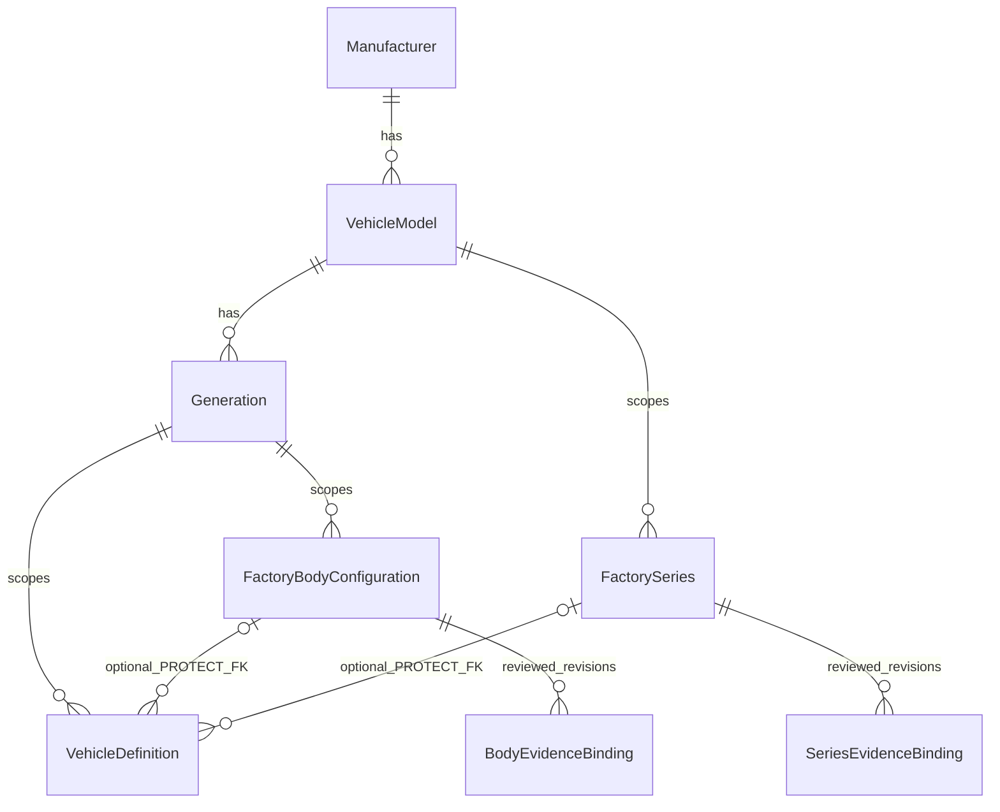

# RA-045 — FactoryBodyConfiguration: Unified Factory Body Identity Architecture

Created: 2026-11-13
Last Updated: 2026-11-13
Status: Approved

**Authority:** Explicit Project Owner approval on 2026-11-13.
**Governing decision:** [accepted ADR-0013](../ADR/ADR-0013-Unified-Factory-Body-Identity.md).
Architecture acceptance includes the scoped amendments recorded in ADR-0013.
The first pure identity/contract-foundation phase is separately authorized; no
operational migration, canonical parent creation, MY2024 candidate regeneration,
correspondence publication or import is authorized. The design and acceptance tests
below remain the detailed specification; proposed implementation versions are not
claims of deployed execution support.

## 1. Recommendation and problem

Use one reusable, Generation-scoped **FactoryBodyConfiguration** reference entity
representing one supported factory body, with sparse explicit dimension fields.
Associate VehicleDefinition through an optional protected ForeignKey. Reuse the
already-planned **FactorySeries** as a separate model-scoped identity when series
is genuinely distinct from trim. Use versioned body-aware candidate, comparison,
planning and execution paths; derive UI visibility from actual canonical alternatives.
Do not use a Wrangler-specific suffix, a JSON/EAV attribute system, or independent
lists of possible dimensions as evidence that a body combination exists.

The [MY2024 continuation audit](../../implementation/handoffs/MY2024_JL/lightweight_ingestion_review_20261113/CONTINUATION_REVIEW_20261113.md)
identifies 31 active consumer configurations: ten two-door and 21 four-door.
Removing Unlimited from trim produces ten cross-body identity/slug collision pairs
and only 21 unique current slugs. CSV/research `body_style` cannot prevent these
merges because it does not participate in persisted or executable canonical identity.
A slug-only fix would leave the semantic defect intact.

This proposal simultaneously supports SUV door configurations and manufacturer
van body form, wheelbase designation, length designation, roof designation and
side-door arrangement. Series participates separately. Stored identity and visible
choices are different questions: an ordinary 2007 4Runner needs no body record, additional review, selector or suffix.

## 2. Verified implementation and authority boundary

Inspected AGENTS.md, GEMINI.md, CURRENT_STATE, ADR-0001/0002/0004–0012, RA-011/014/
016/018/020/022/024/025/044, the W2 domain/publication/implementation designs,
existing ingestion code and the MY2022/MY2023 execution handoffs. Read the MY2024
normalization audit, validation, queue and representative candidate artifacts.
The older W2 design's implementation descriptions are historical; repository code
and the current audit establish actual support.

Read-only database inspection on 2026-11-13 verified **1,053 VehicleDefinitions,
3,350 receipts, 242 correspondence revisions**, with zero MY2024 JL definitions
or applicable published MY2024 JL correspondences. SHA-256:
`172eca0dfd562c4768fcce64802640223748c81b7864ce667fd75051b188bb20`.
No FactoryBodyConfiguration association is currently persisted on VehicleDefinition.
The existing 147-file checkpoint was audited in the continuation; its original
manufacturer PDFs were not located, so do not treat its transcriptions as newly
verified manufacturer originals in this design.

Relevant code paths:

| Area | Current implementation/finding |
| --- | --- |
| Domain | [models.py](../../../reference/models.py): Generation-scoped VehicleDefinition; trim, engine descriptor, five powertrain fields, drive, market; unique Generation/slug; no body/series FK |
| Slug | `VehicleDefinition.build_slug()` and [powertrain.py](../../../reference/powertrain.py): body-independent base and structured engine qualifiers |
| Source/candidate | [contracts.py](../../../reference/ingestion/contracts.py), [builder.py](../../../reference/ingestion/candidate/builder.py), serialization/validation: Candidate 2.1.0 and qualified evidence; research body is nonexecuting metadata |
| Identity | [powertrain_identity.py](../../../reference/ingestion/importing/powertrain_identity.py): exact five-field engine projection and receipt-bound peers, no body distinction |
| Generation | [generation_correspondence.py](../../../reference/ingestion/generation_correspondence.py): reviewed qualified source identities; caller target alone insufficient |
| Authorization/execution | importing/planner.py, importer.py, workflow.py, matrix_workflow.py; manifest.py, matrix.py and matrix_approval.py: exact plans, stale checks, atomic create/receipt and model-year execution |
| Presentation | [services.py](../../../reference/services.py), views/templates: year/trim/configuration discovery and labels; body/series facets are not implemented |

**Existing approved direction is reused, not silently overridden.**
[ADR-0011](../ADR/ADR-0011-Factory-Body-Configuration-Identity.md) and
[W2 domain §§5/8](W2-Full-Specifications-Domain-Architecture.md) already propose
Generation-scoped body identity, separate series, protected optional associations,
explicit missingness, Candidate v3, body manifest 3.0 and full UUID slug qualifiers.
Their reviewed body profile is currently limited to vans and five dimensions;
Wrangler still uses historical trim normalization. This proposal requires explicit
amendment of that scope, mandatory missingness, parent-publication assumptions,
slug policy, dimension/preimage contracts and Wrangler policy.
[ADR-0012](../ADR/ADR-0012-Structured-Powertrain-Identity-And-Hybrid-Terminology.md)
already requires a successor to the engine-name-based `vehicle-definition-body/1`.
Neither accepted ADR is edited here. Future W2 Full Specifications and the
Edmunds-first ingestion workflow named W2 remain separate concepts.

## 3. Owner requirements and classification boundary

For MY2024, canonical trim is Sport, Sahara, Rubicon 392, Willys 4xe, etc., without
Unlimited or a door suffix. Source labels such as Unlimited Sport remain verbatim
assertions/aliases. Wrangler 4xe stays VehicleModel Wrangler within the reviewed JL
Generation; electrification is PHEV and 4xe remains in marketed trims where supported.
MY2019–MY2023 existing identities are not renamed or reinterpreted.

A dimension becomes canonical only after reviewed evidence establishes all of:

1. A manufacturer-recognized factory body/series variant and commercial scope.
2. An explicit combination with the relevant trim/powertrain/body, not co-listing.
3. A structural factory baseline distinction within the reviewed profile, rather
   than owner equipment, a dealer accessory, tuning-only output or a measurement.
4. A defensible boundary relative to otherwise equivalent variants, with known
   qualifiers/conflicts and an attributable owner finding where interpretation is needed.

An option's price, sales code, marketing label or being factory-orderable is not
alone enough. A sliding-door option may be a structural identity on one reviewed
van profile and subordinate equipment on another. Persist the latter through the
existing equipment/catalogue boundary, not as a second body. Transmission-only
alternatives remain subordinate under ADR-0010. Brochure/accessory rules are not
waived. Measurements remain in the existing measurements/specifications domains.

## 4. Proposed explicit domain model

### FactoryBodyConfiguration

One immutable supported body identity with a sparse identity basis, reusable by multiple VehicleDefinitions
across trims, engines and model years **within one Generation**. Generation derives
VehicleModel and Manufacturer; no independently writable duplicate parent chain.
Cross-Generation reuse of a code does not establish the same body entity.

| Proposed fields | Meaning / constraints |
| --- | --- |
| id, UUID, timestamps | Existing integer-PK/UUID/BaseModel conventions; never synthesized in read-only planning |
| generation FK | Required, PROTECT; identity scope immutable |
| profile_id / profile_version | Reviewed interpreting profile, initially proposed `factory-body` / `2.0`; version is interpretation metadata, not a new identity discriminator |
| semantic_identity_digest | Required for established identities, exact canonical preimage below; unique within Generation and the body identity family across interpreting profile versions |
| Seven explicit dimension groups | `body_style`, `wheelbase_designation`, `body_length_designation`, `roof_height_designation`, `door_configuration`, `side_door_arrangement`, `body_code` |
| Per dimension: nullable designation token | Seven explicit nullable scalar groups; body_code additionally has a namespace when populated as identity; blank is normal, with no mandatory status or role checklist |
| Reviewed immutable evidence bindings | Qualified assertions, original labels/codes, normalization rationale, source applicability, reviewer, exact profile/role policy and revision/hash |

This is an explicit Django schema, not one row per arbitrary attribute or a bag
of editable identity JSON. Wire dimension objects are serialized representations
of these columns. Original multilingual labels and multiple manufacturer aliases
belong in source/evidence bindings, outside the immutable semantic key; adding
another source spelling does not create a new body.

`body_style` means body family/form (SUV, cargo, passenger, crew, chassis cab,
cutaway or another reviewed manufacturer designation), **not** the legacy CSV's
2-door/4-door vocabulary. That CSV value maps to `door_configuration` with an
explicit rule retaining its original key/value. Do not overwrite the source column.
Wheelbase/body-length/roof fields store **designations**, never measured millimeters.
A designation token can resemble a number only if its manufacturer-designation
meaning is established; do not derive it by rounding a measurement.

Profiles are bounded normalization/presentation policies over these seven named
fields, not an attribute engine or a requirement to populate them. Only established
identity-bearing fields form the frozen identity basis (§6). Evidence bindings retain
aliases and nonidentity facts separately. No seven-status checklist, universal body
form requirement, or inference of not-applicable/not-differentiated is required.

### FactorySeries

Reuse the separately planned model-scoped entity, with immutable semantic namespace
and designation, UUID, protected VehicleModel and reviewed applicability bindings.
Its existing `factory-series-semantic/1` preimage is retained. Transit 150/250/350
are illustrative series candidates, not automatically trims or body fields.
Where a manufacturer instead uses such a designation as its grade, keep it in trim
and leave the series association null; never assert the same discriminator twice.
Identical bodies can be shared by different series. Differences in rated capacity
alone do not prove a structural body change.

### VehicleDefinition relationship and invariants

Add optional `factory_body_configuration` FK and optional `factory_series` FK,
both PROTECT. ForeignKey, not OneToOne: many year/trim/powertrain baselines can
reference the same body/series. Retain `identity_contract` and a nullable successor
`semantic_identity_digest`; existing rows keep their original contract semantics.
No universal body_binding_status or series_binding_status checklist is proposed.
A null FK alone means no association asserted, not evidence of a universal body,
no distinct series, or completed historical assessment.

A present body FK must match Generation; a present series FK must match its model.
Qualified evidence must support each asserted identity and exact year/market
applicability. Candidate resolution records distinguish absent association from
established binding and actual unresolved conflict, without persisting a mandatory
absence-adjudication status. A v3 candidate may legitimately have neither parent.
Known body distinctions in its reviewed source scope cannot be suppressed by nulls
or by selecting an older candidate version. Five-field engine eligibility and all
existing evidence/Generation approvals remain unchanged.



Bindings retain immutable source attribution, applicability and normal workflow
review findings. Existing reviewed evidence may establish parents directly; an
independent body-review/publication stage is not automatic. Planning describes a
pending parent by semantic key and evidence, never creates it or invents a UUID.
Future canonical write authorization must explicitly cover the exact parent/binding
creation or reuse as well as baseline/receipt creation (§9).

## 5. Sparse missingness and comparison rules

Blank dimensions are normal and contribute no token. They cause no additional
review, missing-evidence error, ineligibility, placeholder record, or mandatory
not-applicable/not-differentiated finding. Ordinary no-body ingestion remains valid.
An omitted body form, roof, side-door arrangement or series is not itself a conflict.

| Situation | Deterministic behavior |
| --- | --- |
| No relevant body distinction established in current canonical scope | No parent required; existing workflow proceeds without body-specific review |
| Known sparse body, e.g. only doors | Resolve supported populated identity basis; remaining dimensions stay null |
| Same supported body through aliases/evidence revisions | Normalize to same scoped tokens and existing frozen basis; reuse, not duplicate |
| Two supported positive configurations differ on an identity-bearing field | Distinct bodies/VDs; different known bodies are not inherently contradictory evidence |
| One side omits a field and available evidence identifies one existing supported configuration | Absence is neutral; reuse the defensible existing identity, without inventing a new variant or claiming the absent fact was sourced |
| Actual source alternatives fit an incomplete candidate equally, or sources assert incompatible values for the same configuration | Review the actual ambiguity/contradiction; no speculative choice, merge or create |

Compatibility is **not equality** and is not transitive. A doors-only observation
cannot merge two evidenced long/short bodies merely because it omits wheelbase.
Resolve using the complete relevant current source/peer set, exact source grouping
and supported equivalence, never first-match iteration or pairwise compatibility
chaining. Null is not a wildcard proving equality, nor proof of inequality. If no
positive distinction or conflicting alternatives exists, do not hypothesize one to
create a review gate. A candidate cannot drop a known discriminator already present
in its source scope to evade separation.

Side-door classification follows §3: supported structural variants distinguish;
ordinary optional equipment stays outside identity. Missing side-door information
requires no independent adjudication. Genuine conflicting evidence remains subject
to existing human review; unsupported values are never filled to obtain eligibility.

## 6. Semantic identity, uniqueness and evolution

### Body preimage — proposed `factory-body-semantic/2`

Closed canonical JSON with a sparse `dimensions` object: only established
identity-bearing named fields are included; at least one is needed to create a body
parent. No empty placeholder parent. Example using the existing Wrangler door taxonomy:

```json
{
  "identity_contract": "factory-body-semantic/2",
  "profile_family": "factory-body",
  "scope": {"manufacturer_key":"jeep","model_key":"wrangler","generation_key":"jl"},
  "dimensions": {"door_configuration":"two-door"}
}
```

The allowed keys remain the seven explicit fields in §4. `body_code`, when truly
identity-bearing, is a namespace/token pair; otherwise it remains an evidence alias.
Tokens use reviewed scoped normalization and existing Token grammar, not automatic
translation, rounded measurements or label-derived registry identifiers. Wrangler
source CSV `body_style=2-door` maps explicitly to `door_configuration` without
changing the raw assertion. Other six fields may remain null without findings.

Use canonical JSON UTF-8 SHA-256: sorted keys, compact separators, ensure_ascii=False,
no NaN. Field order is immaterial. PKs, UUIDs, labels, aliases, evidence hashes,
timestamps and interpreting profile versions are excluded. Qualified source changes
still change artifact/binding hashes, even when semantic identity remains unchanged.

Freeze the supported identity basis when the parent is established. Normalize source
synonyms before hashing; exact basis/preimage uniqueness prevents spelling duplicates.
Before creating a parent, compare existing bodies and source equivalences under §5:
a compatible subset/superset is not automatically a new body or proof of sameness.
A supported equivalence resolves to the existing frozen basis/digest; additional
non-distinguishing facts can enter evidence without changing that identity. No greedy
union of unrelated source rows. Unresolved *actual* multiple matches require review.
A later real distinguishing discovery requires an explicitly reviewed correction or
successor identity and reconciliation of affected bindings/VDs, never mutation of a
referenced immutable key. Hypothetical future discoveries do not block ingestion.

### Successor baseline preimage — proposed `vehicle-definition-body/2`

Exact fields: `identity_contract`, reviewed `scope`, `model_year`, exact approved
`trim_name`, canonical `drivetrain`, `market`, `canonical_powertrain`, `body_digest`,
`series`. `body_digest` and `series` may each be null for no asserted association;
nulls carry no invented absence finding. canonical_powertrain contains the existing **five** fields with RA-044
canonical decimal strings/tokens. A present `series` is `{digest:Hash}`. `engine_name` is a retained descriptor, outside
this successor semantic key. Transmission, packages, physical measurements, display
names and provenance are also outside it. Body and series UUIDs resolve protected
references but are not substitutes for semantic digests.

Two otherwise equal baselines with different established body or series identities
are distinct. Different code spellings, evidence revisions, display labels or
profile versions do not establish distinction. Exact assessed equality means a
possible no-op only after current state/evidence checks, never duplicate creation.

Retain the current sourced-layout/tuning review guard (`nonidentity_variation`):
equal five-field engines do not permit discarding a documented V-versus-inline
layout or contradictory output/applicability evidence. Such cases remain review-
required under RA-044/JL-D20; horsepower alone does not create a second baseline.
This proposal adds body/series identity, not an unapproved expansion of engine identity.

Enforce DB uniqueness on assessed VehicleDefinition `(generation, semantic_identity_digest)`
with a partial constraint applying to new assessed rows; preserve Generation/slug
uniqueness across active and inactive rows. Legacy rows retain null assessed digests
and remain outside this index, not coerced to a sentinel semantic identity. FBC
uniqueness is `(generation, identity_family, semantic_identity_digest)` across
interpreting profile versions, with a hash-collision/preimage comparison in services.
A DB unique index supplements transactional semantic checks; SQL null equality is
not the duplicate algorithm.

Existing body/1 and van/1.0 preimages retain their exact meanings. This expanded
seven-dimension family and engine-aware baseline are **successors**, not edits to
old hashes. A version change cannot bypass duplicate checks: before enabling a
successor creation path for a reviewed scope, perform explicit equivalence/collision
review across older profile/identity versions, reuse existing logical identities
when equivalent and block actual unresolved overlap, never absence alone. Do not enable competing creation
versions for that scope during transition. Compatible evidence/profile revisions
keep semantics; a newly populated dimension already supported by /2 does not by itself need a
new wire contract; a changed frozen identity needs reviewed reconciliation. A new
dimension outside the seven-key vocabulary or changed comparison semantics needs
a successor contract and reviewed transition. There is no automatic semantic widening or linked-row reassignment.

## 7. Versioned ingestion contracts

Candidate v3 / schema **3.0.0** is already reserved but not implemented. Refine that
future boundary through explicit approval rather than silently extending 2.1.0.
If implementation finds a deployed v3 reader/artifact with different approved
semantics, stop and allocate a successor instead of reinterpreting it.

Proposed v3 additions preserve sparse optionality:

- `canonical_powertrain`: existing five-field shape; complete before eligibility.
- `factory_body`: null when no identity is asserted/needed; otherwise a sparse
  identity basis plus qualified evidence and exact applicability. Resolution binds
  an existing parent UUID/digest/binding revision, or a pending semantic parent
  descriptor and evidence for explicitly authorized atomic creation.
- `factory_series`: independently null or an established/pending series binding;
  no mandatory not-separate finding for ordinary trims.
- `canonical_identity_contract`: `vehicle-definition-body/2`; no required body FK
  simply because v3 is used. An actual unresolved identity conflict is recorded in
  resolution diagnostics and blocks the affected action, not represented by a
  fabricated missing-dimension status.

Use closed shapes and qualified evidence for asserted values. Reject caller-only
UUIDs and scope suppression of known discriminators. Resolve Generation, supported
body/series identity where relevant, then full baseline. Candidate hashes bind the
exact sparse projection, evidence, pending-parent disposition and version; historical
hashes retain their meanings. Existing Candidate 2.1/no-body paths remain legitimate
where no known body distinction must be executed, with no gratuitous new proof or
contract requirement just because a field is blank.

| Contract | Proposed path / compatibility |
| --- | --- |
| SourceAssertionSet 1.1.0 | Reuse generic qualified assertion contract; extract body facts and relationships without rewriting old sets; retain reviewed originals/transcriptions honestly |
| Candidate 1/2/2.1 | Read/validate unchanged; body metadata cannot be executed through unknown_fields |
| Candidate 3.0.0 | Explicit body/series and five-field successor above; reject old-executor downgrade |
| Engine Proof 2.0 | Remains unchanged for existing structured-powertrain scope; cannot attest body-aware matching |
| Factory identity/Engine Proof 3.0 | New proof binds full body/series/powertrain tuple, source/binding revisions, relevant live peers including unresolved legacy peers and namespace state; no unverified caller-supplied empty peer proof |
| Resolution 2.0 / Manifest 3.0 / Matrix 3.0 | Explicit body-aware versions bind optional target FKs/digests or exact pending-parent descriptors, semantic contract, new proof, generation resolution, absence/no-op premises and exact candidate hashes; no mixed executable version sets |
| Adjudication 1.0/1.1 | Historical meanings unchanged; current 1.1 implementation explicitly requires 2.1.0, so cannot silently apply to v3 |
| Proposed adjudication 2.0 | Bind exact v3 base digest and qualified body/series/classification findings; separate allowed categories and hard blockers; no owner impersonation, no replacing established facts via null-fill approval |
| Generation correspondence review 1.0 | Reuse when selector, exact source evidence, year/market/target and supported restrictions are unchanged; Generation binding alone does not establish body identity; reuse its source evidence only where it supports doors |
| Body-restricted correspondence | Existing closed restriction keys cannot accept a new body discriminator silently; if such restrictions are required, block and separately version that review contract |
| Receipts | Existing receipt persistence/attribution pattern; new snapshot payload version retains full body/series and proof references; no rewriting historical JSON or receipts |

Evidence binding is part of the normal qualified source/review workflow, not an
automatic second human publication step. Existing reviewed Wrangler Edmunds-first
and manufacturer reconciliation evidence establishes doors without a new body-only
review. Materially new classification or conflicting evidence still needs the
normal owner decision. Exact schema files/limits require later contract approval;
no proposed versions or parent lifecycle is implemented here.

## 8. End-to-end integration and acceptance obligations

| Component | Required body-aware behavior | Compatibility / validation / test obligation |
| --- | --- | --- |
| Source assertions | Preserve original trim, body terms, codes, exact positive configuration grouping, applicability and aliases | Old sets unchanged; test that raw Unlimited labels survive normalized Sport and that co-listed dimensions do not create tuples |
| Normalization | Qualified mapping to designation tokens, sparse identity basis and source equivalence; series/trim separation | No inferred dimensions from adjacent years or numeric measurements; test missing alone versus actual conflicting values |
| Construction | v3 projects body and series independently, with deterministic full hashes | v2 metadata is nonexecuting; test rebuild equality and changed-body hash inequality |
| Candidate identity | Require bindings only for asserted meaningful body/series identities; permit nulls; retain actual unresolved drafts | Caller FK, display label or hash alone cannot establish evidence; test context/source contradictions |
| Peer search/comparison | Search the full same-year/model/Generation/market/grade/drive relevant namespace; compare five engine fields plus body/series semantics | Do not prefilter away other bodies, null/unassessed legacy peers or unsupported aliases; test equal-engine/different-body create and actual ambiguous legacy overlap review |
| Adjudication | Exact-base proposed/approved findings with role, applicability, rationale and qualified evidence | No old approval silently broadened to doors, another year or version; stale base blocks; hard source/parent contradictions cannot be approved away |
| Generation correspondence | Preserve reviewed source-model membership, resolve correct Generation before body | PK 32 context is insufficient; test stale source/binding and out-of-scope year/market; no Generation split merely for MY2024 refresh |
| Import planning | Recompute canonical identity, body/series applicability, peer assessment, unique slug and creation basis | Use body-aware `factory_identity_dimension` basis already planned in ADR-0011; retain first-representation/grade rules; no fake approvals to obtain eligibility |
| Persistence/execution | Protected FKs, immutable body/series, assessed digest, exact target payload; revalidate within transaction | Constraint catches concurrent duplicates; create+receipt atomic; model-year execution re-plans each row only under its existing exact batch authorization protocol |
| Slug | New body-aware deterministic scheme below after semantic assessment | A distinct slug cannot manufacture a distinct identity; all occupied active/inactive slugs block unless exact eligible no-op |
| Display / selectors | Shared context-aware formatter and facets over real canonical rows | Detail/search/browse agree; body invisible for single-body contexts, visible despite narrowing to one selection |

The outer workflow/importer must dispatch the new contract explicitly, not merely
add fields to `target_fields`. `assess_peer`, receipt target-field checks, namespace
snapshots, digest reconstruction, `revalidate_resolution`, stale-plan handling,
manifest approval and matrix reconciliation all need version-aware body/series
bindings. The existing Engine Proof 2.0 receipt reader currently expects old field
sets and Resolution 1.1; it must retain that branch rather than accept extra fields
by ignoring them. New path reads historical peers conservatively, not as fully
assessed body identities.

The new `factory_identity_dimension` create basis is justified only by a reviewed
unequal body/series dimension when otherwise comparable engine/grade/drive fields
match. Different trim alone follows the existing grade evidence/adjudication path;
body is not an escape from missing grade evidence. Source evidence and newly
curated body parents do not authorize canonical writes by themselves.

### Legacy overlap rule

Null legacy associations are neutral: no universal-body inference and no blanket
review gate. Existing exact no-body matches and legitimate legacy workflow no-ops
remain possible when there is no evidenced conflicting body distinction. Do not
claim their body has thereby been assessed or backfill their FK. Inspect known
source grouping, body evidence and relevant peers before creating another baseline.
If actual supported alternatives make the proposed match ambiguous, or known bodies
conflict, require targeted reconciliation rather than using a new slug to bypass it.
Never globally strip Unlimited from historical identities. Corrections/associations
require separate authorization and preserve immutable history. MY2023 rows are not
same-year peers for MY2024; the verified MY2024 namespace was empty at the prior audit.

## 9. Migration, compatibility and rollback

No migrations are created here. Proposed staged sequence:

1. **Accept amended direction and exact contracts first.** Review scoped stable
   keys, profiles/dimension roles, evidence curation and version dispatch. Add
   semantic and compatibility fixtures before enabling production writes.
2. **Add reference parents/bindings.** FactoryBodyConfiguration, FactorySeries and
   their immutable reviewed bindings reuse Reference/domain conventions and PROTECT.
   No seeds, guessed Wrangler rows or automatic source-code parsing in migrations.
3. **Add nullable VD associations and version marker/digest.** Existing 1,053 rows
   retain null FKs/successor digest; their PKs, UUIDs, slugs and attributes
   remain byte/field-stable where the additive schema permits. No body assignment
   from legacy trim names. Add check/index constraints excluding legacy digests.
4. **Implement pure contracts and services behind explicit version dispatch.** Old
   versions continue their original semantics. New writes remain disabled until
   end-to-end transaction tests pass. Reader/display compatibility lands before new
   writer enablement, including supported receipt/snapshot readers.
5. **Reuse normal reviewed evidence.** Resolve the two Wrangler door bases from
   existing taxonomy/reconciliation; do not require a second body-only approval or
   a no-separate-series finding. Planning returns exact reuse/create descriptors,
   sources and applicability. No database writes occur in planning.
6. **Separately authorize MY2024 artifact regeneration and canonical execution.**
   Preserve old bases/sources, create v3 revisions and rebind only changed approval
   subjects; retain existing classification/correspondence gates and Matrix certification.
   A later canonical write authorization must explicitly include needed body/series
   parents and bindings. Execute parent resolution/creation, VD and receipt within
   the authorized atomic transaction. Shared parents are reused by semantic basis,
   not independently reviewed for every engine/trim. Receipts retain created/reused
   parent identities, exact evidence and bindings. Unexpected namespace/parent changes
   trigger existing stale-plan validation/replanning, never silent scope expansion.
   Rollback includes newly created parents/bindings, leaving no orphan on VD failure.

Validate forward migrations on an isolated copy: preserve all canonical rows,
receipt/correspondence payloads and references, source bytes and existing relationships.
Do not use counts alone as proof; compare ordered field/UUID/slug fingerprints and
historical artifact digests. Rehearse rollback on isolated data.

Before body-aware records exist, reversal of strictly additive schema is technically
possible with separately authorized rollback. After any reviewed body curation,
binding, receipt or VD depends on it, do not drop the tables/columns or deploy an
old writer that cannot represent them. Disable new writes and prefer a forward fix;
restore only through a separately authorized consistent recovery plan. Presentation
can hide unfinished UI without discarding internal identities. Downgrade readers
must fail closed or operate read-only on unsupported assessed records, not save
body-aware rows through legacy forms/serializers. No destructive rollback, FK
nulling or receipt rewriting is an acceptable migration shortcut.

## 10. Slugs, names and original terminology

**Verified deployed behavior:** `VehicleDefinition.build_slug()` uses year, trim,
engine descriptor, drivetrain and market, adding structured engine qualifiers when
all five fields exist. `save()` generates it only when blank. `get_absolute_url()`
uses manufacturer/model/Generation slugs plus the persisted VD slug; the configurator
uses that exact URL only after an exact configuration selection. Year/trim filters
do not become full-specification URLs. See [URLs](../../../reference/urls.py) and
[services](../../../reference/services.py). Full body/series UUID suffixes are
accepted *future design* in ADR-0011/W2, not deployed behavior.

Proposed new-record policy, requiring the narrow ADR-0011 amendment:

1. Retain existing structured base and semantic identity assessment first.
2. Add concise normalized human body qualifiers needed to distinguish the reviewed
   configuration family, e.g. `-2-door` and `-4-door`.
3. Add independent manufacturer series/grade tokens where needed, e.g. `-series-250`.
4. If necessary, add an attributable verified model/body code; use a finer ordering
   code only where it appropriately identifies the same canonical configuration.
5. An opaque fallback requires explicit review showing readable/code alternatives
   are genuinely insufficient. It is never the default or a random collision retry.

Pin qualifier policy/token mapping and fixed dimension order (form, wheelbase,
length, roof, doors, side doors, body code; then independent series) in the reviewed
plan. Select the minimal distinguishing qualifier bundle over the reviewed source
configuration family, not whichever row imports first. Both Wrangler door variants
receive their readable qualifier. Later UI filters/aliases never regenerate slugs.
No redundant suffix for ordinary no-body/single-body models. If future knowledge
requires a new distinguishing slug, existing records still retain their immutable URL.

**Ordering-code assessment from retained MY2024 reconciliation:** JLJL72/JLJL74
identify two-/four-door Sport-family bodies but span Sport, Sport S, Willys and
multiple engines; JLJS72/JLJS74 similarly span Rubicon variants. They are not unique
VD keys. Reviewed 23x/24x QOP alternatives can represent subordinate manual/automatic
transmissions, so they cannot split baseline identity or be selected arbitrarily.
Readable doors suffice for the current ten collision pairs; no ordering-code suffix
is needed there. This assessment reuses retained evidence, not new acquisition.

A selected code must have exact manufacturer/source namespace, model/Generation,
year/market/revision applicability, demonstrated meaning and stable reviewed mapping
to the proposed identity. Check reuse, revision changes and broader applicability;
never assume global uniqueness or select the first alias lexically. Prefer stable
model/body codes over codes varying solely with transmission/packages. A code can
qualify a locator without becoming a semantic discriminator; source code differences
alone cannot create a VD. Pin chosen code and rationale in plan/receipt. A later code
revision changes provenance, not an existing slug. No acceptable deterministic code
means targeted locator review, not manufactured identity.

Maintain ADR-0002, Generation/slug uniqueness and the 180-character limit. No silent
truncation, sequential/random repair, default full UUID, or old-slug rewrite. Check
occupied active and inactive locators after semantic comparison; a conflicting locator
requires reviewed policy resolution, not a duplicate semantic row.

Display canonical year/make/model + trim + contextual body/series labels, e.g.
**2024 Jeep Wrangler Sport 4-Door**. Retain original Unlimited Sport in attributed
provenance. Display/alias changes do not change identity or URL. Keep supported 4xe
marketed trims within VehicleModel Wrangler. Stored slug qualifiers and conditional
presentation labels are separate: UI visibility can evolve without changing URLs.

## 11. Conditional presentation: scope, choices and visibility

**Derive visibility; do not persist a `show_body_selector` flag.** Stored identity
and UI state must not diverge because a flag was missed during ingestion.

Define root alternative universe **U** as all public/selectable active canonical
VehicleDefinitions for exactly **VehicleModel, Generation, model year and market**.
Apply authorization/withdrawal visibility and the same domain selection scope
consistently, not the currently selected VD, engine, body UUID or one search-result
page. If year/Generation/market is not established, group results by that root or
ask for the parent selection; do not combine markets/generations to invent choices.
Unimported drafts, quarantine, deferred RHD and unreferenced body parent records
never populate U.

For each reviewed identity dimension D, derive **visibility(D)** from distinct
established meaningful values represented by U. Multiple values make it visible;
one or zero makes it unnecessary as an interactive choice. Not-applicable,
not-differentiated and missing evidence are not fabricated options. Null legacy
rows do not count as another established body; provide attributed evidence details
where relevant, without a mandatory warning or review solely because fields are blank.
Do not falsely assert that only one body existed historically from such data.

**Trim and necessary parent selections constrain availability, not the root
visibility decision.** For ordered facet D, admissible options are the projection
of actual U rows matching selected trim and earlier selected facets (series, form,
wheelbase, length, roof, doors, side-door arrangement as applicable). Changing one
parent clears or explicitly repairs incompatible downstream selections; the service
validates the full final tuple against an actual VD. A prior child/body/engine
selection must not shrink U and hide its own distinction. Where relevant, engine
availability is a dependent facet over these same rows, not another product set.

Thus choosing Sahara may leave only 4-Door available, but a 2024 Wrangler year
context that offers 2-Door/4-Door still shows that dimension as a fixed/disabled
4-Door value. Selecting Sport 4-Door or deep-linking to it likewise does not erase
the control. A 2007 4Runner root with one meaningful body has neither a body selector
nor a redundant body suffix. The fallback evidence-status detail is not a fake
body option. No UI label claims an unassessed null body is a verified sole body.

Implementation should use a bounded scoped projection/grouping query for root
facet values and filtered actual-row lookup for dependent availability, with
`select_related` for body/series labels. Avoid per-result body/visibility queries.
Measure query budgets against the existing configurator service during implementation;
no new cache/visibility service or stored flag is required by this design.

Use one dimension selector when only one meaningful dimension varies (Wrangler
would show Doors). Use independent dimension selectors for van roots with several
varying dimensions. If actual variants cannot be meaningfully separated by resolved
dimension labels, retain a reviewed combined body label/code selector or block
ambiguous presentation; do not expose UUID strings as user choices or fabricate
new dimensions. These choices follow profile metadata and U, not brand-name branches.

Search, browse cards, details and future comparisons share the same root-context
formatter: show body/series qualifiers for dimensions varying in that row's U,
not variation among unrelated search hits or only the selected trim's singleton.
Pinned detail identity always resolves the exact VD/UUID; explicit body details
remain inspectable even when its concise name has no suffix. Public URLs for legacy
records remain stable. Accessible labels, non-JavaScript forms, keyboard/focus
behavior and announced dependent updates remain required implementation tests.

## 12. Worked examples — distinctions, not availability generation

### A. 2007 Toyota 4Runner

An ordinary 2007 4Runner with no established relevant body distinction has no FBC
record or association, no additional body review, no missing-body eligibility error,
no selector and no suffix. This applies to a legitimate new no-body candidate as
well as existing rows; no finding across seven dimensions is required. Null is not
a claim that research has proved only one factory body ever existed. If a real
supported distinction is discovered later, handle that evidence then, not today.

### B. 2024 Wrangler Sport, same proposed engine, different doors

Existing reviewed Edmunds-first taxonomy and manufacturer reconciliation already
establish two-door/four-door. Reuse those exact assertions; no independent body-only
review is needed. Illustrative normalized bindings A/B below describe planned parents,
not minted UUIDs or canonical writes. Other six body fields may remain null.

| Stage | Sport 2-Door | Sport 4-Door |
| --- | --- | --- |
| Source | Retain exact door assertion/model code | Retain door assertion and original Unlimited Sport wording |
| Candidate v3 | Sport; dimensions `{door_configuration:two-door}` | Sport; dimensions `{door_configuration:four-door}` |
| Semantic identity | Body digest A, same evidenced five-field engine tuple | Body digest B; unequal doors prevent engine/trim merge |
| Parent lifecycle | Reuse or explicitly authorized atomic create A | Reuse or explicitly authorized atomic create B |
| Example slug | `2024-sport-36l-v6-ess-4wd-us-2-door` | `2024-sport-36l-v6-ess-4wd-us-4-door` |
| Display | 2024 Jeep Wrangler Sport 2-Door | 2024 Jeep Wrangler Sport 4-Door |

Series remains null when none is independently asserted. These slugs illustrate
the requested readable composition, not a new engine classification. All ten audited
collision pairs are separated by doors; all 31 active proposals should remain
31 identities/slugs after normalization, subject to existing engine/classification,
source and Generation correspondence approvals. No candidates were regenerated.

### C. Ford Transit — illustrative manufacturer-plausible rows

**No manufacturer availability, model year, precise measurement or approved
Transit token is asserted.** Treat each line as one hypothetical positive source
configuration, never permission to generate the missing combinations.

| Example row | Independent series | Trim/grade | Body form | Wheelbase designation | Length designation | Roof designation |
| --- | --- | --- | --- | --- | --- | --- |
| T-A | 150 | Reviewed base grade | Cargo | Regular | Regular | Low |
| T-B | 250 | Same reviewed grade | Cargo | Long | Long | Medium |
| T-C | 350 | Same reviewed grade | Cargo | Long | Extended | High |

FBC-A/B/C differ in reviewed body designations, not numeric dimensions. FactorySeries
150/250/350 are independent identities if supported as such; the same FBC could
also serve two series where their body semantics actually match. A fourth row with
the body of T-B and series 350 must have its own positive coexistence evidence before
a VD/facet option exists. T-B versus T-C demonstrates that equal wheelbase does not
prove equal body length or roof. `Low` is a designation, not inferred from a height
measurement; a historical manufacturer unnamed conventional roof is not renamed Low.

Candidate v3 and assessed baseline bind asserted series and sparse body digests.
Doors, side doors and body code may all remain null without extra review. A proposed
Transit slug uses only needed readable designations/series, e.g. a base followed by
`-long-extended-high-roof-series-350`, within the length limit. Multi-axis UI options derive
only from these actual VDs; selecting regular wheelbase cannot offer T-C's extended/
high combination unless such a row really exists. Illustrative source codes and
UUIDs must not be seeded by a design document.

### D. Van side doors: structural body or equipment

Suppose two otherwise identical reviewed cargo vans are catalogued as a passenger-
side sliding-door structural body and a dual left/right sliding-door structural
body. If source and owner findings establish these as identity-bearing bodies,
use distinct `side_door_arrangement` tokens, FBC digests and VD identities; both
rows have independent supported existence. Keep total doors separate where it has
its own meaning: two layouts may have the same total count and different placement.
An explicitly ordinary optional door-opening mechanism, trim package or unreviewed
co-listed sliding-door option stays in equipment, not another VD. Conflicting
classification remains unresolved. No universal rule that every dual-door option
splits the baseline is introduced. An absent side-door field creates no review gate.

### E. Imported MY2023 Wrangler

An existing MY2023 Unlimited Sport retains its canonical trim, UUID, PK, immutable
slug, receipts and published correspondences. Its body association remains null
unless separately assigned through an authorized correction. Its source assertions
are not normalized again to fit v3. MY2024 Sport/4-Door has a different year, new
VD and reviewed body binding; it does not rename or replace the historical record.
A later same-year proposal follows §8: null alone does not block; actual ambiguous
overlap requires reconciliation and cannot be bypassed with a body-qualified slug.

### F. Partial evidence versus actual contradiction

A Transit source establishes high roof and a supported positive configuration but
omits side doors: use the supported sparse basis, leave side doors null, and proceed
without additional review for that blank. Two consistent aliases for high roof
resolve to the same token/basis. A second source asserting low roof for the *same*
configuration creates a genuine contradiction requiring review. Separate positive
high/low source configurations instead establish valid distinct bodies. If a candidate
could refer to either evidenced alternative and cannot be assigned, review that actual
ambiguity. A doors-only intermediate observation cannot chain-merge known long and
short bodies. A no-body proposal cannot suppress known Wrangler doors in its scope.

## 13. Alternatives and tradeoffs

| Approach | Domain/extensibility | Complexity and query/UI behavior | Historical/migration risk |
| --- | --- | --- | --- |
| **Dedicated sparse FBC with explicit fields; separate series (recommended)** | Reusable structural whole, exact body combinations; supports all required dimensions without arbitrary attributes | One protected join, indexed scalar facets; reuse of normal reviewed evidence across engines/years; bounded parent/binding lifecycle | Additive nullable FK and assessed marker; safe legacy branch; requires versioned end-to-end identity integration |
| Individual dimension entities/relationships | Reusable vocabulary terms but combination existence still needs an explicit whole-body relation | Many joins/curation objects, accidental Cartesian availability; additional whole/constraint entity would recreate FBC | More constraints/migration surfaces; harder to preserve exact combination provenance; not justified by current scope |
| Body fields directly on VehicleDefinition | Simple row access and indexes; no shared body object | Repeated dimension semantics/evidence across every engine/year, difficult independent curation; UI can facet but cannot cheaply reuse a reviewed whole | Wide canonical row changes, duplication/correction risk; does not align with approved separate body/series direction |

Recommendation is driven by demonstrated whole-body reuse and explicit combination
identity, not maximum generic extensibility. Seven dimensions are a bounded schema;
adding a future genuinely independent dimension still requires reviewed semantics,
versioning and migration rather than an open-ended attribute registry.

## 14. Semantic test architecture and rollout gates

All implementation tests use isolated databases/media and bounded original-source
fixtures, never operational writes. Tests must demonstrate false-merge prevention,
not merely JSON acceptance.

| Test family | Required semantic assertions |
| --- | --- |
| MY2024 collision regression | All ten exact pairs in continuation remain distinct after trim normalization; 31 supported rows produce 31 identities/slugs, never 21; unchanged raw Unlimited assertions |
| Equal identity / duplicate prevention | Same body/series/powertrain through another alias/source is no-op after review; no second VD; concurrent duplicate attempts roll back or reject under unique constraint |
| Different bodies / series | Same trim/engine/body except independently established series creates only with supported series distinction; differing wheelbase, length, roof or side-door identity cannot merge |
| Hashing/determinism | Same approved semantic preimage hashes equally despite label/evidence ordering differences; candidate hash changes for any bound evidence change; body change alters assessed baseline digest; timestamps/source hashes stay outside semantic identity |
| Sparse absence / conflict (A, F) | Missing roof/form/doors/series alone creates no review, placeholder or error; no-body v3 and legitimate v2 paths eligible under existing gates; actual conflicting same-configuration values review; supported distinct bodies remain distinct; compatibility chaining cannot merge alternatives |
| Source grouping | Positive tuples survive extraction; absent roof/door/engine cells never arise from co-listing or Cartesian generation; source-code differences alone do not split identities |
| Curation/parents | Wrong Generation/series model/year/market/binding leaf rejected; read-only planning never creates parents; authorized atomic execution resolves/creates from existing reviewed evidence without duplicate review; PROTECT deletion and immutability covered |
| Peer planning | Full relevant namespace includes other bodies and unassessed legacy peers; exact tuple no-op, genuine body/series distinction create basis, null alone permits existing legitimate matching; actual ambiguous legacy overlap review-required |
| Adjudication | Old approvals cannot fill new body/series fields or carry forward years; exact v3 base/support required; stale or contradictory evidence blocks; no unsupported approval simulation |
| Execution / stale state | New body or withdrawn binding/changed source/peer state invalidates old exact authorization; row+receipt and model-year transaction roll back together on failure |
| Historical contracts | Frozen Candidate 1/2/2.1, Engine Proof 2.0, Manifest/Matrix 2.x and receipt fixtures keep original bytes/hash/meaning; old readers reject unsupported v3 semantics rather than dropping fields |
| Migration preservation | Compare all 1,053 PK/UUID/slugs and historical receipt/correspondence snapshots before/after isolated additive migration; zero automatic body assignments or MY2019–MY2023 rewrites |
| Slug lifecycle | Readable body/series qualifiers unique and fixed; reviewed codes tested for scope/revision and transmission-only misuse; opaque fallback requires explicit review; display alias changes leave URLs unchanged; inactive collision blocks; >180 characters blocks without truncation/retry |
| Visibility anchors | Single-body 4Runner root hides selector/suffix; Wrangler root shows doors on Sport and fixed Sahara 4-Door even after exact selection/deep link; selected child cannot collapse its own root |
| Van UI combinations | Multiple dimension facets use only supported rows; no phantom series/body/engine combination; incompatible downstream state cleared explicitly; unknown not rendered as another body |
| Cross-surface/accessibility | Browse/search/detail/comparison share root-based labels; markets/generations never mixed; keyboard/no-JS/deep-link behavior stable; evidence uncertainty remains accessible |
| Profile evolution | Equivalent older semantic/profile versions cannot bypass identity uniqueness; unresolved cross-version equivalence blocks; existing body/series UUIDs are never silently reassigned |

Existing import and receipt suites must continue passing. Perform targeted tests
through implementation phases and one final relevant comprehensive check; avoid
repeated whole-suite runs on every artifact regeneration. MY2024 source adequacy,
classification approvals and correspondence readiness remain separate gates even
when the body regression passes.

## 15. Proposed implementation phases (each separately authorized)

1. **Architecture acceptance:** resolve decisions below; accept scoped ADR amendments,
   exact semantic preimages, profile vocabulary and version matrix. No imports.
2. **Pure contract/service support:** closed v3/identity/proof/adjudication fixtures,
   reviewed body/series curation and source-applicability contracts; legacy fixtures frozen.
3. **Additive persistence:** isolated migration/preservation tests, constraints and
   protected associations; explicit owner authorization before operational migration.
4. **Planning/execution integration:** namespace peers, full identity/create basis,
   versioned manifests/matrices/receipts and stale-state atomicity tests; writes gated.
5. **Presentation integration:** root-derived facets/labels, real-combination lookup,
   accessible selectors and legacy no-suffix behavior. No speculative van seeds.
6. **MY2024 bounded migration of artifacts:** reuse reviewed door evidence and resolve parents within the authorized normal workflow, preserve
   immutable raw transcriptions separately from normalized inventories, create new
   candidate revisions, review classifications/correspondences, certify only after
   full checks, then separately authorize import. Existing quarantine/RHD stays excluded.
7. **Future vans:** acquire only scoped real inventories when authorized; review series
   versus trim and identity-bearing door/body roles, with no configuration product.

No phase is approved for execution by the present design-only instruction. Do not
unblock the guarded MY2024 generator until the relevant contract/persistence path
exists and its own owner approvals are obtained.

## 16. Decisions requiring owner/architect approval

1. Expand ADR-0011 from the reviewed van-only profile to the unified seven-dimension
   body family and independently represented MY2024 Wrangler doors; preserve its
   legacy/no-backfill and immutable identity rules. The proposed ADR identifies
   narrow supersession of ADR-0010's Wrangler trim workaround for **new assessed** rows.
2. Accept sparse Generation-scoped FBC + optional PROTECT FK, independent model-
   scoped FactorySeries, sparse nullable fields, no universal body/series status checklist or missingness review.
3. Approve `factory-body-semantic/2` and `vehicle-definition-body/2`, including
   structured five-field engine identity and version-transition equivalence gates;
   no retrospective interpretation of /1 artifacts.
4. Approve the v3/Manifest 3.0/Matrix 3.0/Resolution 2.0/Proof 3.0/adjudication 2.0
   dispatch and exact schema review scope. Existing correspondence 1.0 can be reused
   only within its unchanged closed restriction/evidence semantics.
5. Amend the planned full-UUID slug policy to readable qualifiers, independently
   meaningful series and verified scoped codes; reviewed opaque fallback only when
   unavoidable, with immutability and 180-character enforcement unchanged.
6. Accept UI root scope (model + Generation + year + market), with trim/parent facets
   constraining availability while root visibility persists, and no stored visibility flag.
7. Approve a later scoped implementation/migration plan, explicitly covering parent/binding creation in canonical write
   authorization without redundant evidence review. Real designation
   vocabularies, field limits and each identity-bearing body finding require evidence
   review; illustrative Jeep/Transit rows are not approvals or seeds.

Known remaining MY2024 evidence and classification blockers are not waived by
approving this design. This proposal stops at the architecture approval boundary.

## 17. Design-only revision and verification record

This targeted revision keeps the reusable domain entity, separate series, protected
associations, integration table, migration strategy, actual-combination UI, alternatives
and semantic test architecture. It removes universal missingness/status and independent
body-review gates, reuses reviewed Wrangler evidence, and replaces proposed UUID-first
slugs with readable qualifiers and scoped-code selection. ADR-0013 lists the precise
accepted-policy amendments; accepted ADRs remain unchanged.

The §2 database counts/hash and prior 21-versus-31 inventory check are the earlier
design audit, not a fresh live-data certification. Revision checks cover local links,
JSON example syntax, headings/fences, sparse hash determinism and the existing 31-row
door separation. Preservation fingerprints cover pre-existing work, including database,
accepted ADRs, CURRENT_STATE, CHANGELOG and candidate artifacts. No Django test suite,
migration, code/schema/contract change, candidate regeneration or database write is
needed for this documentation task. Local links, JSON, metadata, fences, whitespace, numbered sections and examples A–F
passed. In-memory sparse serialization order produced the same digest, while different
door tokens produced different digests. The retained inventory projection reproduced
31 rows, 21 keys without doors and 31 with doors (ten collision pairs). Preservation
checks found only these two authorized drafts changed among 6,138 fingerprinted files;
the database and all other existing work were unchanged. The future implementation
tests in §14 are not claimed passed. No staging, commit or push occurred.

**Review disposition:** no identified unresolved conceptual issue prevents owner
acceptance of this revised proposal. Acceptance of the scoped ADR amendments, sparse
comparison/parent lifecycle, successor version boundaries and slug policy is still
required. Exact implementation contracts, field limits and token fixtures need later
review; current MY2024 classification/correspondence/source gates are not waived.
Acceptance alone authorizes no implementation or canonical write. Stop for review.

## 18. Owner acceptance and bounded implementation authorization

Accepted by explicit Project Owner instruction on 2026-11-13 through ADR-0013.
Sections 16–17 retain the original review/verification history; their requests for
architecture acceptance are now satisfied by that decision. Only the first pure
identity, successor-preimage and Candidate v3 contract-foundation phase with isolated
tests is authorized. Unresolved wire details must be documented rather than invented.
No persistence/UI/import integration, operational migration, MY2024 regeneration or
canonical write is authorized. Implementation results are recorded separately in
CURRENT_STATE and CHANGELOG, not assumed from architecture acceptance.
