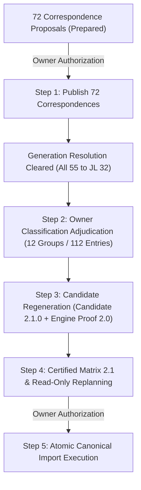

# MY2022 Wrangler JL — Minimal Safe Path to Import Eligibility

This document details the minimal sequential workflow required to advance the 55 provisional MY2022 candidates from their current blocked status to canonical database import.

## Step 1: Generation Correspondence Publication
* **Prerequisites**: Review of the 72 proposal files in `new_correspondence_proposals/` and explicit human authorization.
* **Action**: Execute atomic publication of the 72 reviewed correspondence revisions using `publish_correspondence(...)`.
* **Effect**: Inserts 72 `GenerationCorrespondenceRevision` records and 72 `ImportExecutionReceipt`s. Clears `review_category = generation_correspondence` for all 55 candidates.
* **Tooling**: `reference/management/commands/publish_generation_correspondence.py` or an authorized batch publication script.
* **Rollback**: Publication is transactional. Revisions are version-controlled and immutable.

## Step 2: Powertrain Classification Adjudication
* **Prerequisites**: Resolution of the 12 classification review groups (112 null entries) and the High Tide trim vs. package decision.
* **Action**: Create approved `ClassificationAdjudication` artifacts for:
  1. `EC1` (2.0L Turbo): fuel=`gasoline`, electrification=`none` (14 candidates)
  2. `ERC` (3.6L V6 non-eTorque): aspiration=`naturally_aspirated`, fuel=`gasoline`, electrification=`none` (13 candidates)
  3. `ERG` (3.6L V6 eTorque): aspiration=`naturally_aspirated`, fuel=`gasoline` (15 candidates; electrification is already `mild_hybrid`)
  4. `EXJ` (3.0L EcoDiesel): electrification=`none` (9 candidates; fuel and aspiration already populated)
  5. `ECX` (2.0L 4xe PHEV): fuel=`gasoline` (3 candidates; electrification and aspiration already populated)
  6. `ESG` (6.4L Rubicon 392): aspiration=`naturally_aspirated`, fuel=`gasoline`, electrification=`none` (1 candidate)
  7. High Tide: Confirm marketed trim name `Unlimited High Tide` or reclassify to `Unlimited Sport S` with Beach Package.
* **Tooling**: `reference/ingestion/classification_adjudication.py`.

## Step 3: Candidate Regeneration
* **Action**: Re-run candidate construction to produce immutable replacement Candidate 2.1.0 artifacts with complete five-field identities and valid `reconciliation_and_review.requires_human_review = False`.
* **Engine Proofs**: Generate 55 `EngineProof` 2.0 artifacts with verified peer absence.
* **Lineage**: Follow ADR-0006/ADR-0010; candidates receive deterministic revision names (`.candidate.2.1.0.json`).

## Step 4: Certified Matrix & Read-Only Replanning
* **Action**: Generate the MY2022 generation trim matrix and run the read-only planner.
* **Expected Outcome**: All 55 candidates return:
  * `eligibility_status = eligible`
  * `planned_action = create`
  * `create_basis = first_representation` (or mechanical distinction)
  * `target_slug` uniquely populated

## Step 5: Authorized Canonical Import Execution
* **Action**: Execute atomic model-year transaction to import the 55 configurations into `VehicleDefinition` and persist 55 `ImportExecutionReceipt`s.
* **Safety Invariants**: Create-only baseline; no overwriting of existing data.
